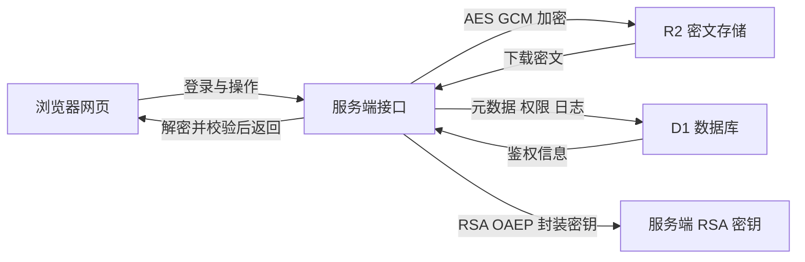

# 密盾传输 SecureVault

基于 AES-256-GCM 与 RSA-OAEP 的前后端一体化文件安全传输系统。系统面向毕业设计演示和小型文件共享场景：上传文件会先加密再进入对象存储，下载必须通过身份、权限、有效期和完整性验证。

## 已实现功能

- ChatGPT 账号身份验证与用户数据隔离
- AES-256-GCM 文件内容加密，每个文件使用独立随机密钥和 IV
- RSA-OAEP SHA-256 文件密钥封装，私钥仅保存在服务端环境变量
- D1 保存文件元数据、共享权限与审计日志
- R2 只保存加密后的文件对象
- 文件上传、解密下载、限时邮箱共享和删除
- AES-GCM 认证标签与 SHA-256 摘要双重完整性检查
- 中文响应式网页、在线使用说明和可下载 Word 手册

## 系统结构

## 本地运行

1. 安装 Node.js 22.13 或更高版本。
2. 执行 `npm install` 安装依赖。
3. 首次运行执行 `npm run keys:generate`，生成本机 RSA 密钥。
4. 执行 `npm run dev`，打开终端显示的网址。

项目已包含可直接使用的本地密钥文件，但 `.env` 不会提交到代码仓库。重新生成密钥会使旧密钥加密的文件无法解密，因此部署后不要随意执行第三步。

## 常用检查

- `npm test`：验证混合加密解密闭环和篡改拒绝行为。
- `npm run lint`：检查代码质量。
- `npm run build`：生成生产部署版本。
- `/api/health`：检查数据库绑定与服务状态。

## 目录说明

- `app/SecureVaultApp.tsx`：主要中文网页界面和交互逻辑。
- `app/api`：上传、下载、共享、删除、仪表盘和健康检查接口。
- `lib/crypto.ts`：AES-GCM 与 RSA-OAEP 核心实现。
- `lib/database.ts`：数据库初始化和审计日志。
- `db/schema.ts`：数据库表结构。
- `drizzle`：可追踪的数据库迁移文件。
- `密盾传输系统使用手册.docx`：正式用户及答辩演示手册。

## 安全边界

当前版本适合毕业设计和小型受控演示，单文件限制为 15 MB。正式的大文件生产系统应增加分块加密、断点续传、密钥版本管理、病毒扫描、配额策略和独立密钥管理服务。系统不自行设计加密算法，而是组合浏览器及云端 Web Crypto 提供的标准算法。

正式地址默认采用仅所有者可访问的私密发布。需要演示跨账号共享时，应先把测试账号加入网站访问名单，再在系统内按邮箱创建文件共享；两层授权缺一不可。
